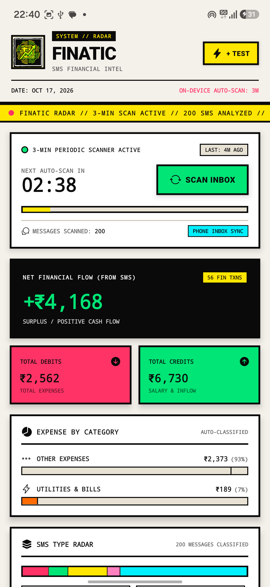
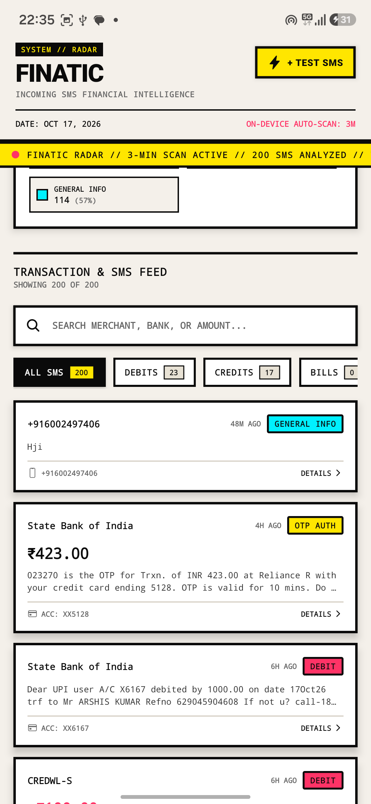

# ⚡ FINATIC // ON-DEVICE SMS FINANCIAL RADAR

<p align="center">
  
</p>

<p align="center">
  <b>A High-Contrast Neo-Brutalist React Native Android Application Engineered for Automated 3-Minute SMS Parsing, Real-Time Financial Entity Extraction, and Privacy-First Spending Intelligence.</b>
</p>

<p align="center">
  
  
  
  
</p>

---

## 🏛️ System Architecture & Working Pipeline

Finatic operates on a strictly decoupled, **zero-cloud-dependency** pipeline. The entire flow—from raw telephony queries to regex tokenization, metadata entity extraction, aggregate computation, and UI rendering—takes place entirely on the local device.

```
┌─────────────────────────────────────────────────────────────┐
│                    ANDROID TELEPHONY OS                     │
│               (content://sms/inbox Provider)                │
└──────────────────────────────┬──────────────────────────────┘
                               │ android.permission.READ_SMS
                               ▼
┌─────────────────────────────────────────────────────────────┐
│             NATIVE KOTLIN MODULE (SmsModule.kt)             │
│   Direct ContentResolver Query (ID, Address, Body, Date)    │
└──────────────────────────────┬──────────────────────────────┘
                               │ JNI / React Native Bridge
                               ▼
┌─────────────────────────────────────────────────────────────┐
│              TYPESCRIPT ABSTRACTION SERVICE                 │
│                 (src/services/smsReader.ts)                 │
└──────────────────────────────┬──────────────────────────────┘
                               │ Raw Message Stream
                               ▼
┌─────────────────────────────────────────────────────────────┐
│             FINANCIAL NLP & REGEX TOKENIZER                 │
│                 (src/services/smsParser.ts)                 │
│  - Type Classification (DEBIT / CREDIT / OTP / BILL / SPAM) │
│  - Balance Stripping & Amount Normalization                 │
│  - Merchant Matching & Expense Category Inference           │
│  - Account & Card Digit Extraction (XX####)                 │
└──────────────────────────────┬──────────────────────────────┘
                               │ Parsed Entities
                               ▼
┌─────────────────────────────────────────────────────────────┐
│               LOCAL PERSISTENCE & ANALYTICS                 │
│                (src/services/smsStorage.ts)                 │
│  - AsyncStorage Caching & Delta Ingestion                   │
│  - Aggregated Metrics: Net Flow, Inflow, Outflow, Categories│
└──────────────────────────────┬──────────────────────────────┘
                               │ State Subscription
                               ▼
┌─────────────────────────────────────────────────────────────┐
│            NEO-BRUTALIST REACTIVE PRESENTATION              │
│                 (src/screens/HomeScreen.tsx)                │
│  - 3-Minute Interval Scanner & Progress Countdown           │
│  - Financial Summary & Category Breakdown Cards             │
│  - Real-Time Filterable / Searchable Transaction Feed       │
└─────────────────────────────────────────────────────────────┘
```

---

## 🔬 Technical Working Structure

### 1. Telephony Extraction Engine (`SmsModule.kt`)
Android encapsulates SMS data inside a protected SQLite Content Provider. Finatic accesses this natively via a custom Kotlin module:
- **URI Target**: `content://sms/inbox`
- **Projection**: `arrayOf("_id", "address", "body", "date", "read")`
- **Ordering**: `date DESC LIMIT 200`
- **Bridge Export**: Exposes `@ReactMethod fun list(filterJson: String, errorCallback: Callback, successCallback: Callback)` which serializes the cursor into a lightweight JSON array transferred across the React Native C++ bridge.

### 2. 3-Minute Periodic Scanner (`scannerService.ts`)
The periodic scanner combines foreground UI timers with background tasks to ensure live reactivity:
- **Foreground Interval**: A reactive 1-second interval ticks down from `180` to `0` seconds. At `0`, an asynchronous re-scan is dispatched to query the inbox, update the storage layer, recalculate metrics, and reset the countdown timer.
- **Manual Force Scan**: Users can bypass the timer at any time by pressing `SCAN INBOX`, triggering an immediate fetch and resetting the timer.
- **Background Synchronization**: Standalone builds register with `expo-background-fetch` and `expo-task-manager` under the task key `FINATIC_SMS_PERIODIC_SCAN_TASK`. In the sandboxed Expo Go client, background registration is bypassed via `expo-constants` environment detection to prevent console warnings.

<p align="center">
  
  <br />
  <i>Figure 1: Live Status Card showing 3-Minute countdown, Net Flow summary (+₹4,168), Debits vs Credits, and Categorized Expense breakdown.</i>
</p>

### 3. Financial NLP & Regex Parser (`smsParser.ts`)
The parsing engine executes multi-stage heuristic analysis on each message string:

#### A. Balance Collision Avoidance
A critical challenge in SMS parsing is avoiding the extraction of remaining account balances (e.g., `Avail Bal: Rs 48,200`) instead of the transaction amount. Finatic strips balance patterns first using word-boundary regular expressions before searching for transaction amounts:
```typescript
const bodyWithoutBal = body.replace(
  /\b(?:avail(?:able)?\s*bal(?:ance)?|bal|balance|credit\s*limit)\b\s*[:\-]?\s*(?:rs\.?|inr|₹|\$|usd|€|eur|£|gbp)?\s*[0-9,]+(?:\.[0-9]{1,2})?/gi,
  ' '
);
```

#### B. Amount & Multi-Currency Normalization
The engine matches currency codes (`₹`, `$`, `€`, `£`, `INR`, `USD`, `EUR`, `GBP`) located either as prefixes or suffixes with comma-separated numbers:
```typescript
const regexBefore = /(?:rs\.?|inr|₹|\$|usd|€|eur|£|gbp)\s*([0-9]{1,3}(?:,[0-9]{2,3})*(?:\.[0-9]{1,2})?|[0-9]+(?:\.[0-9]{1,2})?)/i;
```

#### C. Type Classification Hierarchy
Messages are evaluated sequentially through priority tiers:
1. **OTP / 2FA**: Checks for tokens (`\b(\d{4,8})\b`), verification codes, and one-time password indicators.
2. **Promotional**: Identifies loan approvals, voucher codes, discounts, and marketing terms.
3. **Investments**: Detects mutual fund units, SIP executions, demat notices, and dividend payments.
4. **Bill Due**: Identifies payment deadlines, minimum amounts due, and statement generation notices.
5. **Debits**: Matches words such as `debited`, `spent`, `paid`, `withdrawn`, `charged`, `purchase of`, and `debit card`.
6. **Credits**: Matches `credited`, `deposited`, `salary`, `refund`, `cashback`, and `received`.

#### D. Merchant & Expense Category Inference
Identifies known commercial merchants (e.g., Swiggy, Zomato, Starbucks, Amazon, Uber, Netflix, Shell) or parses unstructured merchant clauses like `at [Merchant]`, `to VPA [id]`, or `to [Name]`. Automatically categorizes transactions into `FOOD_DINING`, `SHOPPING`, `UTILITIES_BILLS`, `GROCERIES`, `TRAVEL_TRANSPORT`, `ENTERTAINMENT`, `SALARY_INCOME`, or `INVESTMENTS`.

<p align="center">
  
  <br />
  <i>Figure 2: Real-time classified SMS feed showing State Bank of India OTPs, UPI debits, sender alphanumeric IDs, and category filter pills.</i>
</p>

---

## 🎨 Neo-Brutalist Visual Design System

Finatic implements a strict Neo-Brutalist aesthetic engineered with high-contrast accessibility:

| Element | Specification | Visual Purpose |
| :--- | :--- | :--- |
| **Borders** | `2.5px - 3.5px` solid `#0A0A0A` | Structural definition and raw industrial framing |
| **Drop Shadows** | `4px 4px 0px #0A0A0A` (Zero blur) | Tactile physical elevation without gradient softening |
| **Paper Canvas** | `#F4F0EA` (Raw warm bone) | Glare reduction and tactile paper feel |
| **Inflow / Credit** | Electric Lime (`#00E575`) | Immediate visual affirmation of positive cash flow |
| **Outflow / Debit** | Hot Coral (`#FF3366`) | Clear alert contrast for expenses and deductions |
| **OTP / Auth** | Cyber Canary Yellow (`#FFE600`) | High-priority security and action notices |
| **Typography** | Monospace Numerals + Heavy Sans Headers | Machine-like readability for financial audits |

---

## 🛠️ Build & Developer Verification

### Automated Test Suite
Finatic includes a standalone test runner that validates regex accuracy against live banking SMS formats:
```bash
npm run test:parser
```

**Verification Results:**
```text
--- STARTING SMS PARSER VERIFICATION ---
Test #1: HDFC Bank: Rs. 1,420.00 debited...    -> PASS (Type=DEBIT, Amount=₹1420, Merchant=Swiggy)
Test #2: Chase: You made a $42.50 debit...     -> PASS (Type=DEBIT, Amount=$42.5, Merchant=Starbucks)
Test #3: Dear Customer, INR 85,000.00 credited -> PASS (Type=CREDIT, Amount=₹85000, Category=SALARY)
Test #4: Your HDFC Credit Card statement...    -> PASS (Type=BILL_DUE, Amount=₹14820)
Test #5: 392019 is your secret OTP...          -> PASS (Type=OTP_AUTH, OTP=392019)
Test #6: Pre-approved Personal Loan...         -> PASS (Type=PROMOTIONAL, Amount=₹500000)
Test #7: Zerodha: SIP executed! Rs 5,000...    -> PASS (Type=INVESTMENT, Amount=₹5000)
--- RESULT: 7 / 7 TESTS PASSED (100%) ---
```

### Static Analysis
```bash
npx tsc --noEmit        # Zero type errors
npx expo-doctor         # 21/21 environment checks passed
```

### Compiling Standalone APK
To compile the APK with the embedded JavaScript bundle and native telephony modules:
```powershell
# 1. Package offline bundle into Android assets
npx expo export:embed --platform android --dev false --entry-file index.ts --bundle-output android/app/src/main/assets/index.android.bundle --assets-dest android/app/src/main/res

# 2. Compile APK using Gradle
cd android
.\gradlew.bat assembleDebug --no-daemon
cd ..

# 3. Output located at:
# android/app/build/outputs/apk/debug/app-debug.apk
```

---

## 🔒 Privacy & Security

Finatic does not communicate with external analytics servers, ads, or third-party tracking services:
- **Local Analysis**: All regular expressions, NLP entity extractors, and summary aggregations execute purely within the device's JavaScript engine.
- **Local Storage**: Transaction history and settings are persisted strictly in private application storage via `AsyncStorage`.
- **Zero Cloud Leak**: Your personal SMS communications remain entirely within your device's boundary.
